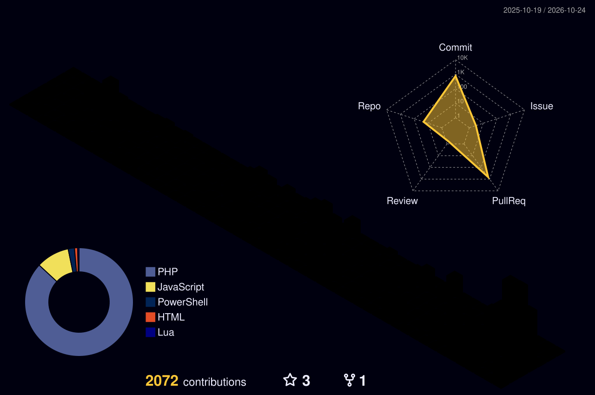

<h1 align="center">Hey, I'm Audric 👋</h1>

  

  
  
  

---

## 🇬🇧 A bit about me

I started as a graphic designer, became a web developer, and now I live in Japan, where I work at a convenience store and build tools in my spare time.

I like making things that solve a real problem. **Kintai**, my main project, started at the store: scheduling and clocking in were a pain, so I built a tool for it. Today the store uses it.

Outside of code you'll find me with a camera, tinkering with my home server and home automation, playing video games, or learning more Japanese 🈶 (currently aiming for N3).

## 🇫🇷 Un peu plus sur moi

J'ai commencé comme graphiste, je suis devenu développeur web, et je vis maintenant au Japon, où je travaille dans un konbini et où je construis des outils sur mon temps libre.

J'aime créer des choses qui règlent un vrai problème. **Kintai**, mon projet principal, est né au magasin : les plannings et le pointage étaient pénibles, alors j'ai construit un outil pour ça. Aujourd'hui, le magasin l'utilise.

En dehors du code : photo, serveur maison et domotique, jeux vidéo, et japonais 🈶 (objectif N3).

## 🇯🇵 自己紹介

グラフィックデザイナーからウェブ開発者になり、今は日本でコンビニで働きながら、個人でツールを作っています。

実際の困りごとを解決するものづくりが好きです。メインプロジェクトの **Kintai** は、店舗のシフト管理や勤怠の不便さを解決するために作り、今では実際に店舗で使われています。

趣味は写真、自宅サーバーとホームオートメーション、ゲーム、そして日本語の勉強です 🈶（現在はN3を目指しています）。

---

## ⭐ Featured project

### ⏱️ [Kintai](https://github.com/AudricSan/Kintai)
Open-source shift scheduling, time clocking, leave and daily reports for shops with several stores. Built from real needs, modular, available in 🇫🇷 🇬🇧 🇯🇵.

## 🧩 Other things I've made

- 🈴 [**KanaTraining**](https://github.com/AudricSan/KanaTraining): a website to learn hiragana, katakana and kanji
- 📸 [**Photographics 2.0**](https://github.com/AudricSan/Photographics-2.0): a free tool for photographers to put their photos online
- 🗾 [**Ma vie au Japon**](https://github.com/AudricSan/Ma-vie-au-Japon): my guide to living in Japan (FR)
- 🛠️ [**PS1-Script**](https://github.com/AudricSan/PS1-Script): small PowerShell automations

## 🧰 What I use

<b>Dev</b>

  

  
  

<b>Creative & tools</b>

  
  

## 🎮 Off the keyboard

| | |
|---|---|
| 📷 **Photography & video** | Lightroom, Premiere, a camera in the bag. Photographics came from this. |
| 🏠 **Home server & home automation** | Docker Compose, Home Assistant, Nextcloud, Jellyfin, Zigbee. If it can be automated, I'll try. |
| 🎮 **Video games** | I like modding my games: Minecraft mods a few years ago, and [Factorio mods](https://github.com/AudricSan/Factorio-Mods) more recently. Plus streaming tools and overlays for fun. |
| 🤖 **Robotics** | Playing with a Cozmo robot and its Python SDK. |
| 🈶 **Japanese language & culture** | Daily practice at work, aiming for JLPT N3. |

## 📈 Activity

  

---

## 📫 Let's talk

Got a project, a question, or a role in mind? I'm happy to chat, in French, English or Japanese.

  <a href="https://www.linkedin.com/in/audricrosier">LinkedIn</a> · <a href="mailto:odorikurojie@gmail.com">Email</a>

